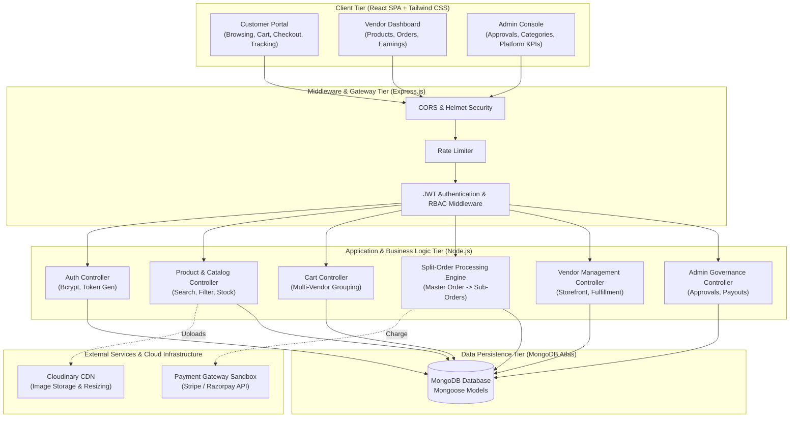
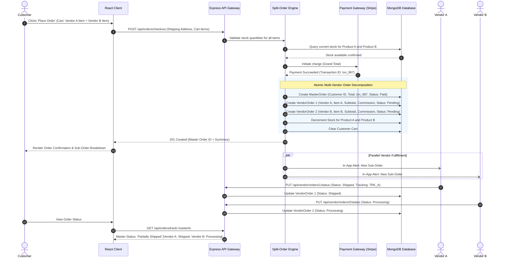
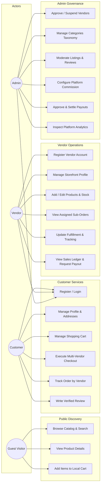

# Software Requirements Specification (SRS)
## MultiCart – Multi-Vendor E-Commerce Shopping Website

---

**Project Title:** MultiCart – Multi-Vendor E-Commerce Shopping Website  
**Degree Program:** Bachelor of Science in Computer Science (B.Sc. CS)  
**Academic Document Type:** Final Year Project Software Requirements Specification (SRS)  
**Standard Compliance:** IEEE Std 830-1998 / ISO/IEC/IEEE 29148:2018 Standards  
**Document Version:** 1.0.0  
**Status:** Approved / Baseline  
**Date:** November 2026  

---

### Document Control & Revision History

| Version | Date | Description of Changes | Author / Role | Status |
| :--- | :--- | :--- | :--- | :--- |
| **0.1.0** | Nov 01, 2026 | Initial draft, problem definition, and scope analysis | Lead Software Engineer | Draft |
| **0.5.0** | Nov 01, 2026 | Added functional & non-functional requirements and user roles | Systems Analyst | In Review |
| **0.9.0** | Nov 01, 2026 | Completed ER diagram, use cases, database schemas, and architecture | Full-Stack Architect | Under Evaluation |
| **1.0.0** | Nov 01, 2026 | Finalized baseline SRS with split-order engine and roadmap | Project Lead & Documentation Engineer | Approved |

---

## Table of Contents

1. [Introduction](#1-introduction)
   - 1.1 Purpose
   - 1.2 Document Conventions
   - 1.3 Intended Audience and Reading Suggestions
   - 1.4 Project Scope
   - 1.5 References
2. [Overall Description](#2-overall-description)
   - 2.1 Product Perspective
   - 2.2 Product Features Summary
   - 2.3 User Classes and Characteristics
   - 2.4 Operating Environment
   - 2.5 Design and Implementation Constraints
   - 2.6 User Documentation
   - 2.7 Assumptions and Dependencies
3. [System Features & Functional Requirements](#3-system-features--functional-requirements)
   - 3.1 Module 1: Authentication & Role-Based Access Control (RBAC)
   - 3.2 Module 2: Admin Dashboard & Platform Governance
   - 3.3 Module 3: Vendor Storefront & Product Management
   - 3.4 Module 4: Product Catalog, Search & Filtering
   - 3.5 Module 5: Shopping Cart & Multi-Vendor Cart System
   - 3.6 Module 6: Multi-Vendor Checkout & Split-Order Processing Engine
   - 3.7 Module 7: Payment Gateway Integration
   - 3.8 Module 8: Order Tracking & Fulfillment
   - 3.9 Module 9: Product Reviews & Rating System
   - 3.10 Module 10: Notifications & Alert System
4. [External Interface Requirements](#4-external-interface-requirements)
   - 4.1 User Interfaces
   - 4.2 Hardware Interfaces
   - 4.3 Software Interfaces
   - 4.4 Communications Interfaces
5. [Non-Functional Requirements](#5-non-functional-requirements)
   - 5.1 Performance Requirements
   - 5.2 Security Requirements
   - 5.3 Reliability and Availability
   - 5.4 Usability and Accessibility
   - 5.5 Maintainability and Scalability
   - 5.6 Portability and Data Integrity
6. [System Architecture & Data Flow](#6-system-architecture--data-flow)
   - 6.1 Architectural Pattern (MERN Layered Architecture)
   - 6.2 High-Level Architecture Diagram
   - 6.3 Multi-Vendor Split-Order Sequence Flow
7. [Use Case Analysis & Detailed Specifications](#7-use-case-analysis--detailed-specifications)
   - 7.1 Global Use Case Diagram
   - 7.2 Detailed Use Case Specifications (UC-01 to UC-07)
8. [Database Design & Entity-Relationship (ER) Diagram](#8-database-design--entity-relationship-er-diagram)
   - 8.1 Database Modeling Strategy
   - 8.2 Entity-Relationship (ER) Diagram
   - 8.3 Detailed Schema Data Dictionaries
9. [Hardware and Software Requirements](#9-hardware-and-software-requirements)
   - 9.1 Hardware Requirements
   - 9.2 Software Requirements
10. [Assumptions, Constraints and Dependencies](#10-assumptions-constraints-and-dependencies)
    - 10.1 Assumptions
    - 10.2 Constraints
    - 10.3 Dependencies
11. [Project Limitations and Future Scope](#11-project-limitations-and-future-scope)
    - 11.1 Current Limitations
    - 11.2 Future Enhancements
12. [Project Development Roadmap](#12-project-development-roadmap)
13. [Proposed Clean Project Directory Structure](#13-proposed-clean-project-directory-structure)

---

## 1. Introduction

### 1.1 Purpose
The purpose of this Software Requirements Specification (SRS) document is to provide a complete, formal, and structured specification of the software requirements for the web-based software application **MultiCart – Multi-Vendor E-Commerce Shopping Website**. This document details both functional and non-functional requirements, interfaces, system architecture, database design, use case scenarios, and implementation constraints.

This document serves as the foundational agreement between the project stakeholders, academic evaluators, and development engineers for the B.Sc. Computer Science Final-Year Capstone Project. It will guide the design, implementation, verification, and final defense of the MultiCart platform.

### 1.2 Document Conventions
This document adheres to the IEEE 830-1998 standard recommended practice for Software Requirements Specifications. The following typographical and priority conventions are used throughout:
- **Bold text** indicates system entities, interfaces, user roles, or key technical terms.
- `Code font` denotes database fields, API endpoints, software packages, or file paths.
- Requirement identification tags follow a standardized naming convention: `[FR-<MODULE>-<ID>]` for Functional Requirements and `[NFR-<CATEGORY>-<ID>]` for Non-Functional Requirements.
- Priorities are classified into:
  - **High:** Core functionality essential for the initial baseline release and academic evaluation.
  - **Medium:** Significant feature required for a realistic operational marketplace.
  - **Low:** Value-added capability that can be deferred or refined in subsequent iterations.

### 1.3 Intended Audience and Reading Suggestions
This document is targeted towards:
1. **Academic Project Supervisors and Defense Examiners:** To review the academic rigor, architectural soundness, system scope, and technical depth.
2. **Software Developers (Full-Stack):** To reference architectural layers, API contracts, schema structures, and business rules during coding.
3. **Quality Assurance (QA) Testers:** To build test plans, test suites, and traceability matrices verifying that all requirements are met.
4. **Prospective Vendors and Administrators:** To comprehend platform capabilities, workflows, and governance models.

Reading suggestion: Readers interested in high-level functionality should examine Sections 2 and 3; technical evaluators should focus on Sections 6, 7, and 8.

### 1.4 Project Scope
**MultiCart** is an enterprise-grade multi-vendor e-commerce web platform designed to eliminate the barriers between independent sellers and digital consumers. Unlike traditional single-vendor e-commerce websites (where one store manager controls inventory and orders), MultiCart provides a decentralized marketplace ecosystem.

#### Scope Inclusions:
- **Customer Portal:** Product discovery, categorized search, multi-faceted filtering, persistent shopping cart across devices, multi-vendor unified checkout, order tracking, and product review submission.
- **Vendor Portal:** Self-registration, digital storefront management, inventory and SKU management, product listing with image upload, sub-order fulfillment lifecycle (Pending -> Processing -> Shipped -> Delivered), earnings analytics, and payout requests.
- **Admin Governance Portal:** Platform-wide oversight, vendor identity verification and store approval, category taxonomy management, commission configuration, product moderation, dispute oversight, and financial settlements.
- **Split-Order Processing Engine:** A specialized business logic engine that takes a single customer cart containing items from multiple vendors, collects a single unified payment, and automatically decomposes the master order into independent sub-orders assigned to each vendor.

#### Scope Exclusions:
- Physical warehouse shipping logistics (the platform provides status tracking and tracking number assignment, but does not operate physical fleets).
- Direct multi-currency forex conversions (the initial baseline uses a single configured currency, e.g., USD / INR).
- Automated banking escrows via automated ACH clearing (the system manages digital ledger accounts and simulated payout disbursements).

### 1.5 References
1. IEEE Std 830-1998: *IEEE Recommended Practice for Software Requirements Specifications*.
2. ISO/IEC/IEEE 29148:2018: *Systems and Software Engineering — Life Cycle Processes — Requirements Engineering*.
3. Pressman, R. S., & Maxim, B. R. (2020). *Software Engineering: A Practitioner's Approach* (9th ed.). McGraw-Hill Education.
4. React.js Documentation: [https://react.dev/](https://react.dev/)
5. Express.js Framework Guide: [https://expressjs.com/](https://expressjs.com/)
6. MongoDB Manual & Mongoose ODM: [https://www.mongodb.com/docs/](https://www.mongodb.com/docs/)
7. RFC 7519: *JSON Web Token (JWT)*, IETF Standards Track.

---

## 2. Overall Description

### 2.1 Product Perspective
MultiCart is a greenfield, autonomous web application structured around the modern **MERN** stack (MongoDB, Express.js, React.js, Node.js). It functions as a cloud-ready, responsive, multi-tenant digital marketplace. The system interfaces externally with cloud image services (Cloudinary) for media asset storage and payment service providers (Stripe / Razorpay sandbox) for payment processing.

The platform replaces fragmented physical retail and isolated single-owner web stores by creating a shared digital bazaar where multiple merchants operate autonomously under a centralized governance umbrella.

```
+-----------------------------------------------------------------------------------+
|                                  MULTICART SYSTEM                                 |
|                                                                                   |
|  +--------------------+     +---------------------+     +----------------------+  |
|  |   Customer Web     |     |    Vendor Web       |     |   Admin Governance   |  |
|  |   Experience UI    |     |   Dashboard UI      |     |     Console UI       |  |
|  +---------+----------+     +----------+----------+     +-----------+----------+  |
|            |                           |                            |             |
|            +---------------------------+----------------------------+             |
|                                        |                                          |
|                                        v                                          |
|                         +------------------------------+                          |
|                         |  RESTful API Gateway / Node  |                          |
|                         |   Express Application Tier   |                          |
|                         +--------------+---------------+                          |
|                                        |                                          |
|            +---------------------------+----------------------------+             |
|            |                           |                            |             |
|            v                           v                            v             |
|  +--------------------+     +---------------------+     +----------------------+  |
|  |  MongoDB Database  |     |  Cloudinary Storage |     |   Payment Gateway    |  |
|  |  (Mongoose Schemas)|     |   (Product Assets)  |     |   (Stripe Sandbox)   |  |
|  +--------------------+     +---------------------+     +----------------------+  |
+-----------------------------------------------------------------------------------+
```

### 2.2 Product Features Summary
1. **Unified Multi-Vendor Shopping Experience:** Customers can mix items from different sellers into one unified cart and check out in a single transaction.
2. **Decoupled Vendor Workspaces:** Vendors operate secure, isolated dashboards where they only see their own products, inventory levels, sub-orders, earnings, and analytics.
3. **Automated Order Splitting:** The backend decomposes multi-vendor cart checkouts into isolated vendor sub-orders with independent shipping workflows.
4. **Role-Based Access Control (RBAC):** Cryptographically enforced permissions using JWT tokens ensuring actors can only execute sanctioned actions.
5. **Media Pipeline:** Secure image transformation, optimization, and remote CDN distribution via Cloudinary.
6. **Platform Commission & Settlement Engine:** Configurable percentage-based platform commissions automatically deducted from vendor sales.

### 2.3 User Classes and Characteristics

The system defines three primary operational user roles plus one unauthenticated visitor role:

| User Class | Technical Privilege Level | Primary Responsibilities & Characteristics |
| :--- | :--- | :--- |
| **System Administrator (Super Admin)** | High / Full System Superuser | Platform owner. Responsible for vetting vendor registrations, approving storefronts, managing category trees, monitoring commission earnings, reviewing audit logs, moderating abusive reviews/products, and approving vendor payout disbursements. High computer literacy. |
| **Vendor (Seller / Merchant)** | Moderate / Store-Scoped Access | Business owner or retail vendor. Registers an online store, configures business details, uploads product listings with images and stock counts, manages incoming orders, updates fulfillment statuses (shipped, delivered), tracks store revenue, and requests payouts. Moderate computer literacy. |
| **Customer (Buyer)** | Standard User Access | End consumer. Browses product listings, conducts keyword searches, applies attribute filters, maintains a persistent cart and wishlist, submits multi-vendor orders, executes secure payments, tracks shipping progress, and posts verified reviews. Variable computer literacy (interface must be straightforward and intuitive). |
| **Guest / Visitor** | Anonymous / Read-Only | Unregistered user. Can view public home page, browse categories, view product details, search products, and add items to local cart prior to mandatory authentication at checkout. |

### 2.4 Operating Environment
- **Server OS:** Ubuntu Linux 22.04 LTS / Windows Server 2022 / Local Development Windows 10/11.
- **Runtime Environment:** Node.js v20.x or v22.x LTS.
- **Web Application Framework:** Express.js 4.x / 5.x.
- **Database System:** MongoDB Community Edition v7.0+ or MongoDB Atlas Cloud Cluster.
- **Client Web Browsers:** Google Chrome (v100+), Mozilla Firefox (v100+), Microsoft Edge (v100+), Apple Safari (v15+), Mobile Chromium / Safari.
- **Network Protocol:** HTTP/1.1 and HTTP/2 over TLS 1.3 (HTTPS).

### 2.5 Design and Implementation Constraints
1. **Technology Constraints:** Application must strictly utilize React.js for frontend, Node.js and Express.js for backend APIs, and MongoDB with Mongoose ODM for data storage.
2. **Stateless Architecture:** Authentication must be stateless using JSON Web Tokens (JWT) stored in secure HTTP-only cookies or Authorization headers to allow horizontal scalability.
3. **NoSQL Schema Relationships:** While MongoDB is a NoSQL document database, multi-vendor marketplace logic requires referential integrity (Vendor -> Products -> Orders). This must be enforced at the application/Mongoose validation layer.
4. **Academic Project Timeframe:** Development must be structured within an 8-to-16-week academic semester timeframe.

### 2.6 User Documentation
The application will deliver:
- An online, responsive **Help & FAQ** page accessible to customers.
- A **Vendor Onboarding & User Manual** embedded in the vendor dashboard.
- An **API Specification (Swagger / Postman Collection)** describing all backend endpoints for evaluation.
- Comprehensive codebase documentation with inline JSDoc comments and setup scripts.

### 2.7 Assumptions and Dependencies
- **Assumptions:**
  - Users possess devices capable of running modern HTML5/CSS3/JavaScript-compliant web browsers.
  - An uninterrupted internet connection is available for API communication and asset loading.
  - Vendors provide genuine inventory counts and fulfill orders independently.
- **Dependencies:**
  - Cloudinary API availability for image hosting and dynamic resizing.
  - Stripe or Razorpay sandbox gateway availability for processing test transactions.
  - NPM package ecosystem reliability (React, Express, Mongoose, Tailwind, Axios, etc.).

---

## 3. System Features & Functional Requirements

### 3.1 Module 1: Authentication & Role-Based Access Control (RBAC)

#### Description
Provides secure identity management, account creation, credential verification, and permission enforcement for all user categories.

#### Functional Requirements:
- **[FR-AUTH-01] User Registration:** The system shall allow visitors to register as a Customer or apply as a Vendor by submitting full name, unique email address, password, phone number, and role selection.
- **[FR-AUTH-02] Password Security:** The system shall enforce a minimum password length of 8 characters containing at least one uppercase letter, one digit, and one special symbol. All passwords must be salted and hashed using `bcrypt` (minimum 10 salt rounds) before persistence.
- **[FR-AUTH-03] User Authentication (Login):** The system shall authenticate users against their registered email and hashed password, issuing a signed JSON Web Token (JWT) containing `userId`, `role`, and expiration timestamp upon successful verification.
- **[FR-AUTH-04] Role-Based Route Protection:** The system shall intercept incoming API requests via Express middleware to verify token authenticity and ensure that only authorized roles (Admin, Vendor, Customer) can access corresponding protected routes.
- **[FR-AUTH-05] Token Lifecycle & Expiration:** The system shall issue JWTs with a defined expiration (e.g., 24 hours). Expired or tampered tokens must be rejected with HTTP 401 Unauthorized.
- **[FR-AUTH-06] Profile Management:** Authenticated users shall be able to view and update their profile data, including contact information and shipping/billing addresses.
- **[FR-AUTH-07] Secure Logout:** The system shall invalidate client-side sessions upon logout by clearing tokens stored in local storage or clearing the HTTP-only authentication cookie.
- **[FR-AUTH-08] Vendor Status Check:** When an authenticated vendor attempts to access vendor tools, the system must check the `vendorStatus` field; if `pending` or `suspended`, the user is restricted from publishing products.

#### Role-Based Access Control (RBAC) Permissions Matrix

| Platform Capability / Endpoint Area | Anonymous Guest | Registered Customer | Registered Vendor | Super Administrator |
| :--- | :---: | :---: | :---: | :---: |
| Browse Catalog, Search, View Details | **Allowed** | **Allowed** | **Allowed** | **Allowed** |
| Add Items to Cart & View Cart | **Allowed** | **Allowed** | **Allowed** | **Allowed** |
| Multi-Vendor Order Checkout | Denied (Prompt Login) | **Allowed** | Denied (Customer Role Required) | Denied |
| Submit Verified Product Review | Denied | **Allowed** | Denied | Moderation Only |
| View Customer Profile & Edit Address | Denied | **Allowed** | **Allowed** | **Allowed** |
| Change Account Password | Denied | **Allowed** | **Allowed** | **Allowed** |
| Apply for Vendor Virtual Storefront | **Allowed** | **Allowed** | N/A (Already Registered) | N/A |
| Access Vendor Merchant Dashboard | Denied (403) | Denied (403) | **Allowed** | Denied (403) |
| Publish / Delist Store Products | Denied (403) | Denied (403) | **Allowed (Approved Only)** | Moderation Only |
| Fulfill & Ship Vendor Sub-Orders | Denied (403) | Denied (403) | **Allowed** | View All |
| View All Marketplace Registered Users | Denied (403) | Denied (403) | Denied (403) | **Allowed** |
| Approve / Reject Vendor Applications | Denied (403) | Denied (403) | Denied (403) | **Allowed** |
| Deactivate / Reactivate User Accounts | Denied (403) | Denied (403) | Denied (403) | **Allowed** |

#### Vendor Onboarding & Verification State Machine
Vendors register through a formal onboarding workflow with three distinct states:
1. `pending`: Initial state upon registration. The vendor profile is created with `isVerified: false`. The user can log into their vendor dashboard to view their store details and application status, but catalog product creation and order dispatch tools are locked.
2. `approved`: Transitioned by Super Administrator after reviewing business credentials. Sets `isVerified: true`. Unlocks full product creation, inventory management, and sub-order fulfillment capabilities.
3. `rejected`: Transitioned by Super Administrator if business information fails commercial verification standards. Stores `rejectionReason` and renders clear feedback to the vendor applicant.
4. `suspended`: Administrative sanction for vendors violating marketplace policies. Product listings are hidden from customer search results.

#### RESTful Authentication & User Management API Endpoints

| HTTP Method | Route Endpoint | Access Level | Description |
| :--- | :--- | :--- | :--- |
| `POST` | `/api/auth/register-customer` | Public | Registers a new consumer account with role `customer`. |
| `POST` | `/api/auth/register-vendor` | Public | Submits a vendor application with store details and role `vendor` (status: `pending`). |
| `POST` | `/api/auth/login` | Public | Authenticates credentials with `bcrypt.compare`, issues signed JWT token. |
| `GET` | `/api/auth/me` | Protected (Any) | Returns current user profile and linked vendor storefront (if applicable). |
| `PUT` | `/api/auth/profile` | Protected (Any) | Updates user full name, contact phone, and shipping address. |
| `PUT` | `/api/auth/change-password` | Protected (Any) | Verifies current password and cryptographically updates new password. |
| `GET` | `/api/admin/users` | Protected (Admin) | Returns complete user directory with optional `?role=` query filter. |
| `PUT` | `/api/admin/users/:id/toggle-status` | Protected (Admin) | Toggles user `isActive` status (activates or deactivates account). |
| `GET` | `/api/admin/vendors` | Protected (Admin) | Lists vendor applications with optional `?status=` query filter and populated user data. |
| `PUT` | `/api/admin/vendors/:id/status` | Protected (Admin) | Modifies vendor status to `approved`, `rejected`, or `suspended`. |
| `GET` | `/api/vendor/profile` | Protected (Vendor) | Retrieves authenticated vendor's storefront profile and status. |
| `PUT` | `/api/vendor/profile` | Protected (Vendor) | Updates store description, logo, banner, and facility address. |

---

### 3.2 Module 2: Admin Dashboard & Platform Governance

#### Description
Enables super administrators to govern the marketplace, manage vendor lifecycle, define product taxonomies, supervise orders, and inspect platform financial health.

#### Functional Requirements:
- **[FR-ADM-01] Vendor Verification & Approval:** The admin shall view a list of all vendor registration applications with business details and approve, reject, or suspend vendor accounts.
- **[FR-ADM-02] Category Taxonomy Management:** The admin shall create, read, update, and delete (CRUD) product categories and subcategories, including category name, description, slug, and thumbnail icon.
- **[FR-ADM-03] Platform Commission Configuration:** The admin shall configure default platform commission percentages (e.g., 10%) or custom rates per vendor, automatically applied during order payout calculations.
- **[FR-ADM-04] Marketplace User Management:** The admin shall search, view, activate, and deactivate any customer or vendor account violating platform terms.
- **[FR-ADM-05] Product Catalog Moderation:** The admin shall have oversight over all active listings across all vendors, with authority to delist or flag non-compliant or counterfeit items.
- **[FR-ADM-06] Platform Analytics & KPIs:** The admin dashboard shall display aggregate platform metrics: total gross merchandise value (GMV), net platform commission revenue, total active vendors, total registered customers, and daily/monthly order volumes.
- **[FR-ADM-07] Payout Authorization:** The admin shall review pending payout withdrawal requests submitted by vendors, verify ledger balances, and mark payouts as completed or rejected.
- **[FR-ADM-08] System Audit Logging:** The system shall log significant administrative events (vendor approvals, account suspensions, category alterations) with timestamps and admin IDs.

---

### 3.3 Module 3: Vendor Storefront & Product Management

#### Description
Empowers approved vendors to manage their independent virtual storefront, catalogue products, track inventory, fulfill sub-orders, and inspect store earnings.

#### Functional Requirements:
- **[FR-VND-01] Storefront Profile Customization:** The vendor shall configure their store name, logo, banner, store bio, customer service contact, and business registration info.
- **[FR-VND-02] Product Creation:** The vendor shall publish new products specifying title, description, category, price, discount/sale price, SKU, stock quantity, tags, and product specifications.
- **[FR-VND-03] Multi-Image Asset Upload:** The vendor shall upload multiple high-resolution images per product, which are processed, resized, and securely hosted via Cloudinary.
- **[FR-VND-04] Product Lifecycle Management:** The vendor shall update product details, modify pricing, toggle visibility (Active/Draft/Out of Stock), or soft-delete products.
- **[FR-VND-05] Inventory & Stock Depletion Alert:** The system shall automatically decrement stock upon successful customer checkout and visually flag low-stock items (< 5 units) on the vendor dashboard.
- **[FR-VND-06] Vendor Sub-Order Dashboard:** The vendor shall view an isolated list of orders containing only items purchased from their store, with access to customer shipping details.
- **[FR-VND-07] Fulfillment Status Progression:** The vendor shall update the status of their assigned sub-order through sequential states: `Pending` -> `Processing` -> `Shipped` -> `Delivered` or `Cancelled`.
- **[FR-VND-08] Tracking Number Input:** When marking an order as `Shipped`, the vendor shall optionally input a courier name and shipment tracking number.
- **[FR-VND-09] Vendor Earnings Ledger:** The system shall compute vendor gross revenue, deducted platform commission, and net withdrawable balance for completed deliveries.
- **[FR-VND-10] Payout Request Submission:** The vendor shall request a withdrawal payout when their settled account balance meets the minimum withdrawal threshold.

---

### 3.4 Module 4: Product Catalog, Search & Filtering

#### Description
Delivers a fast, responsive, and intuitive product discovery mechanism for customers and visitors.

#### Functional Requirements:
- **[FR-CAT-01] Dynamic Catalog Browsing:** The system shall render products by category, subcategory, featured items, newly arrived items, and top-rated items.
- **[FR-CAT-02] Full-Text Fuzzy Search:** The system shall provide an index-backed search bar matching keywords against product titles, descriptions, categories, and vendor names.
- **[FR-CAT-03] Multi-Faceted Attribute Filtering:** The system shall permit users to filter products simultaneously by:
  - Category / Subcategory
  - Price range (minimum and maximum slider)
  - Star rating (e.g., 4 stars and above)
  - Specific Vendor / Store
  - In-stock availability
- **[FR-CAT-04] Dynamic Sorting:** The system shall support sorting by Price (Low to High, High to Low), Customer Rating, Newest Arrivals, and Popularity.
- **[FR-CAT-05] Detailed Product View:** The product details page shall present an image gallery with thumbnail preview, title, breadcrumbs, vendor store link, verified rating summary, pricing, stock indicator, detailed description, and customer reviews.
- **[FR-CAT-06] Public Vendor Store Page:** Customers shall be able to click on a vendor's name to view the vendor's dedicated public storefront, store rating, and complete collection of active products.

---

### 3.5 Module 5: Shopping Cart & Multi-Vendor Cart System

#### Description
Manages temporary and persistent selections of products across multiple sellers before checkout.

#### Functional Requirements:
- **[FR-CRT-01] Multi-Vendor Item Aggregation:** The shopping cart shall support items originating from multiple distinct vendors within the same cart instance.
- **[FR-CRT-02] Visual Vendor Grouping:** The cart interface shall visually group cart line items by their respective vendor, displaying vendor name, items, unit prices, subtotal per vendor, and overall cart total.
- **[FR-CRT-03] Cart Persistence:** For authenticated customers, cart state shall be synchronized to the MongoDB database; for guest visitors, cart state shall be maintained in browser `localStorage` and merged into the user account upon authentication.
- **[FR-CRT-04] Quantity Modification & Removal:** Customers shall increment, decrement, or remove product line items in the cart, with immediate recalculated subtotal, tax, and grand total.
- **[FR-CRT-05] Real-Time Stock Validation:** Prior to transitioning to checkout, the system shall validate that the requested quantities for every line item are currently available in the vendor's inventory.
- **[FR-CRT-06] Price Change Alerts:** If a vendor updates a product's price while it sits in a customer's cart, the cart shall notify the customer and update to the current active price before payment.

---

### 3.6 Module 6: Multi-Vendor Checkout & Split-Order Processing Engine

#### Description
The central core of the marketplace: processes single-cart payments and orchestrates the automatic division of purchases into independent vendor sub-orders.

#### Functional Requirements:
- **[FR-ORD-01] Unified Multi-Vendor Checkout:** The customer shall complete a single checkout flow providing shipping address, contact phone, and payment method, regardless of how many vendors are represented in the cart.
- **[FR-ORD-02] Master Order Creation:** The system shall create a single `MasterOrder` entity capturing: customer ID, grand total, payment status, payment transaction ID, shipping address, and creation timestamp.
- **[FR-ORD-03] Automatic Split-Order Decomposition:** For every distinct vendor represented in the purchased items, the engine shall atomically generate a separate `VendorOrder` (sub-order) document linked to the `MasterOrder`.
- **[FR-ORD-04] Sub-Order Attributes:** Each `VendorOrder` shall contain:
  - Reference to `masterOrderId`
  - Target `vendorId`
  - Array of purchased items for that specific vendor (Product ID, Title, Quantity, Unit Price)
  - Subtotal amount for that vendor
  - Platform commission calculated for that vendor slice
  - Vendor earnings balance (`subtotal - commission`)
  - Independent fulfillment status (`Pending`, `Processing`, `Shipped`, `Delivered`, `Cancelled`)
  - Vendor tracking number field
- **[FR-ORD-05] Atomic Inventory Decrement:** Order creation must occur within a transactional context that immediately decrements the respective product `stockQuantity` to prevent overselling.
- **[FR-ORD-06] Cart Purging:** Upon confirmed order creation, the customer's active shopping cart shall be automatically purged.
- **[FR-ORD-07] Master Order Aggregate Status:** The `MasterOrder` status presented to the customer shall reflect the combined state of its sub-orders (e.g., "Partially Shipped" if Vendor A has shipped but Vendor B is processing; "Delivered" once all sub-orders are delivered).

---

### 3.7 Module 7: Payment Gateway Integration

#### Description
Facilitates secure customer transactions using digital payment gateways and Cash on Delivery (COD).

#### Functional Requirements:
- **[FR-PAY-01] Payment Gateway Support:** The system shall integrate with Stripe (or Razorpay) in sandbox mode for processing credit/debit card and simulated UPI/NetBanking transactions.
- **[FR-PAY-02] Cash on Delivery (COD) Option:** The system shall support a COD payment method, which marks the master order as `Payment Pending` until confirmed upon physical delivery.
- **[FR-PAY-03] Secure Card Handling (PCI-DSS Compliance):** The system shall never store raw credit card numbers or CVVs on its servers; payments must be tokenized directly via the payment provider's client-side SDK.
- **[FR-PAY-04] Webhook Processing:** The backend shall implement a secure webhook listener to receive asynchronous payment confirmation events from the payment gateway and update order payment statuses accordingly.
- **[FR-PAY-05] Payment Failure Handling:** If a payment transaction fails or is aborted by the customer, the system shall roll back reserved inventory and preserve the customer's shopping cart items.
- **[FR-PAY-06] Simulated Refund Workflow:** In case of order cancellation prior to shipping, the system shall record a refund transaction and adjust vendor pending balances.

---

### 3.8 Module 8: Order Tracking & Fulfillment

#### Description
Provides transparency to customers and tracking capabilities to vendors across all stages of order delivery.

#### Functional Requirements:
- **[FR-FLF-01] Customer Order History:** Customers shall access a comprehensive order history listing all past and active master orders with date, order ID, items, and total spend.
- **[FR-FLF-02] Granular Sub-Order Tracking:** For a selected order, the customer shall view the separate fulfillment status of items from each distinct vendor (e.g., "Vendor TechStore: Shipped [Tracking #12345]" and "Vendor FashionHub: Processing").
- **[FR-FLF-03] Visual Timeline Stepper:** The UI shall render a visual step progress indicator displaying: `Order Placed` -> `Processing` -> `Shipped` -> `Out for Delivery` -> `Delivered`.
- **[FR-FLF-04] Customer Order Cancellation:** Customers shall be permitted to cancel an order only while the sub-order status remains `Pending`. Once marked `Processing` or `Shipped`, cancellation is disabled.
- **[FR-FLF-05] Delivery Confirmation:** When a vendor marks an order as `Delivered`, the system records the delivery timestamp and initiates the vendor earnings hold period.

---

### 3.9 Module 9: Product Reviews & Rating System

#### Description
Enables social proof, customer feedback, and quality assurance through verified ratings.

#### Functional Requirements:
- **[FR-REV-01] Verified Purchase Verification:** The system shall only permit a customer to write a review and submit a rating (1 to 5 stars) for a product they have purchased with order status `Delivered`.
- **[FR-REV-02] Review Composition:** A review shall consist of a numerical star rating (1 to 5), a headline, and a written commentary.
- **[FR-REV-03] Real-Time Rating Aggregate:** When a new review is submitted, the system shall recalculate the product's average rating and total review count, as well as the vendor's overall store rating.
- **[FR-REV-04] Single Review per Product:** A customer shall be restricted to one review per purchased product, with the capability to edit their existing review.
- **[FR-REV-05] Admin Review Moderation:** Administrators shall have authority to inspect and delete fraudulent, offensive, or defamatory reviews.

---

### 3.10 Module 10: Notifications & Alert System

#### Description
Keeps all three stakeholders updated on critical transactional events.

#### Functional Requirements:
- **[FR-NOT-01] In-App Notification Center:** The frontend header shall feature a notification bell indicator displaying unread operational alerts for the active user.
- **[FR-NOT-02] Customer Notifications:** Customers shall receive immediate alerts upon: Order Placed, Payment Confirmed, Vendor Sub-Order Shipped (with tracking details), and Order Delivered.
- **[FR-NOT-03] Vendor Notifications:** Vendors shall receive real-time alerts upon: New Sub-Order Received, Inventory Low-Stock threshold reached, and Payout Disbursed.
- **[FR-NOT-04] Admin Notifications:** Administrators shall receive alerts upon: New Vendor Registration awaiting approval and Vendor Payout Request submitted.

---

## 4. External Interface Requirements

### 4.1 User Interfaces & Frontend Design Specifications

#### 4.1.1 UI Design System & Styling Architecture
The MultiCart frontend is developed as a modern, responsive Single Page Application (SPA) utilizing **React.js (v18+)** and styled using **Tailwind CSS (v3+)**. The interface follows a minimalist, content-first design aesthetic adhering to standard human-computer interaction (HCI) and accessibility (WCAG 2.1 AA) principles:
- **Typography:** Primary typeface is **Plus Jakarta Sans** (Google Fonts) with system-ui fallbacks (`sans-serif`), utilizing font weights ranging from 400 (Regular body) to 900 (Black headings) for clean hierarchy.
- **Color Palette:**
  - *Primary Corporate Blue:* `#1E3A8A` (Tailwind `blue-900` / `blue-800`) for headers, primary action buttons, and active states.
  - *Secondary Accent Blue:* `#2563EB` (Tailwind `blue-600`) for focus rings, interactive hover links, and badges.
  - *Vendor Warm Gold / Amber:* `#F59E0B` (Tailwind `amber-500` / `amber-400`) for vendor storefront cards, ratings, and "Become a Seller" badges.
  - *Success Emerald Green:* `#10B981` (Tailwind `emerald-500`) for in-stock indicators, verified badges, and discount tags.
  - *Alert Rose / Red:* `#EF4444` (Tailwind `rose-500` / `red-500`) for clearance sale badges and item removal actions.
  - *Neutrals:* `#0F172A` (Slate-900) for text, `#F8FAFC` (Slate-50) for card and body backgrounds, and `#E2E8F0` (Slate-200) for borders.
- **Responsive Breakpoints:**
  - `sm` (640px): Mobile portrait / large handsets
  - `md` (768px): Tablet / iPads
  - `lg` (1024px): Laptops and standard desktop displays
  - `xl` (1280px) & `2xl` (1536px): Widescreen workstation monitors

---

#### 4.1.2 Navigation Structure & Route Hierarchy

The application employs `react-router-dom` to implement declarative client-side routing. The global navigation tree is organized as follows:

| Route Path | Associated Page Component | User Access Level | Description & Core Purpose |
| :--- | :--- | :--- | :--- |
| `/` | `Home.jsx` | Public (All) | Main landing page: promotional hero banner, categories, featured/latest products, verified sellers. |
| `/products` | `Products.jsx` | Public (All) | Searchable and filterable marketplace catalog with multi-vendor faceted sidebar. |
| `/products/:slug` | `ProductDetails.jsx` | Public (All) | Detailed product view: gallery, specifications, vendor card, quantity selector, reviews. |
| `/categories` | `Categories.jsx` | Public (All) | Visual taxonomy grid displaying all product categories with item counts and banners. |
| `/cart` | `Cart.jsx` | Public (All) | Multi-vendor persistent cart: segregates line items by seller, computes subtotal and grand total in INR. |
| `/login` | `Login.jsx` | Public (Unauthenticated) | Role-based authentication portal with role tabs (Customer, Vendor, Admin) & one-click demo logins. |
| `/register` | `Register.jsx` | Public (Unauthenticated) | Account creation page with dynamic fields for Customer vs. Vendor Store Name registration. |
| `/become-seller` | `Register.jsx` | Public (Unauthenticated) | Direct alias to Vendor registration onboarding screen. |
| `/about` | `AboutUs.jsx` | Public (All) | Platform mission, comparison between single-store and multi-vendor models, and architecture. |
| `/contact` | `ContactUs.jsx` | Public (All) | Customer care directory, message transmission form, and interactive expandable FAQ accordion. |

---

#### 4.1.3 Detailed Page Specifications

1. **Global Navigation Bar (`Navbar.jsx`):**
   - *Top Promotional Bar:* Shows announcement of 50+ verified vendors and free shipping threshold (₹1,999).
   - *Brand Identity:* MultiCart logo with glowing shopping cart icon and marketplace subtitle.
   - *Navigation Links:* Home, Categories, Products, About Us, Contact Us, and an accentuated "Become a Seller" pill.
   - *Live Cart Trigger:* Displays shopping cart icon with real-time numeric counter badge and monetary preview in INR (`₹4,999`).
   - *User Profile & Authentication:* Displays "Login" and "Register" buttons when unauthenticated; displays user avatar, name, and role badge (`Customer`, `Vendor`, `Admin`) with dropdown sign-out when authenticated.
   - *Responsive Mobile Drawer:* Full-width collapsible slide-out drawer on viewports $< 1024\text{px}$.

2. **Home Page (`Home.jsx`):**
   - *Hero Section (`HeroBanner.jsx`):* Shopping headline, value proposition ("Shop from 50+ independent sellers"), CTA buttons ("Shop Now", "Become a Seller"), metrics counters (50+ Sellers, 10,000+ Items, 4.9★ Rating), and floating multi-vendor split-order badge.
   - *Category Showcase:* Responsive 6-column grid displaying category thumbnails and active item counts.
   - *Featured Products Section:* Curated 4-column product grid with discount badges, INR pricing, vendor names, and instant "Add to Cart" actions.
   - *Marketplace Spotlight Banner:* Call-to-action banner recruiting new independent retail vendors with explanation of the zero monthly listing fee model.
   - *Latest Arrivals:* Recently added vendor items showcasing dynamic product discovery.
   - *Verified Sellers Showcase:* Cards highlighting approved sellers (e.g., Apex Electronics, Urban Threads, Casa Craft Home) with store ratings and direct storefront links.
   - *Customer Testimonials:* Verified buyer and seller reviews validating marketplace credibility.

3. **Products Catalog Page (`Products.jsx`):**
   - *Search Input:* Full-text search matching product titles, descriptions, and vendor names with instant clearing.
   - *Faceted Desktop Filter Sidebar:*
     - Categories filter list with item counts.
     - Maximum price range slider (₹500 to ₹8,000+).
     - Merchant/Vendor checkboxes for filtering by specific store.
     - Customer star rating filters (4.5★, 4.0★, 3.5★, Any).
     - Filter reset button.
   - *Sorting Controls:* Dropdown sorting by Featured/Recommended, Price (Low to High, High to Low), Customer Rating, and Newest Arrivals.
   - *Empty State Handler:* Dedicated zero-result container with guidance to broaden filters.

4. **Product Details Page (`ProductDetails.jsx`):**
   - *Interactive Image Gallery:* Main high-resolution viewport with clickable thumbnail selector.
   - *Storefront Attribution:* Prominent card showing vendor name, verified badge, vendor star rating, and direct store link.
   - *Pricing & Savings:* Price in INR (`₹4,999`), original strikethrough price (`₹7,999`), and calculated savings pill.
   - *Stock Indicator & SKU:* Real-time inventory status ("In Stock - 24 units remaining") and SKU tracking code.
   - *Interactive Quantity Selector:* Step buttons (`-` and `+`) bounded by available inventory.
   - *Product Highlights:* Bullet checklist of verified technical and physical specifications.
   - *Verified Customer Reviews:* Customer critiques with star ratings, verified buyer badges, and timestamps.
   - *Related Items Carousel:* Contextual product recommendations belonging to the same category.

5. **Multi-Vendor Shopping Cart Page (`Cart.jsx`):**
   - *Multi-Vendor Segregation:* Line items grouped by vendor store with individual vendor subtotal headers.
   - *Quantity Adjustment & Removal:* Immediate recalculation of line totals and grand totals.
   - *Order Summary Box:*
     - Item Subtotal in INR
     - Applied promotional discount
     - Estimated delivery fee (Free above ₹1,999)
     - Grand Total in INR
   - *Simulated Checkout Modal:* Demonstrates the multi-vendor split-order concept by showing how unified payment decomposes into separate vendor fulfillment streams.

6. **Authentication Pages (`Login.jsx` & `Register.jsx`):**
   - *Role-Switching Tabs:* Allows signing in as Customer, Vendor, or System Administrator.
   - *One-Click Demo Fill:* Preset buttons to test Buyer, Vendor, or Admin credentials during academic presentation.
   - *Dynamic Seller Registration:* Automatically exposes "Commercial Store Name" and "Business Contact" fields when the Vendor role is chosen.

7. **About Us Page (`AboutUs.jsx`):**
   - Educational presentation contrasting traditional single-owner e-commerce limitations against MultiCart's unified split-order architecture.
   - Highlights of academic final-year project objectives and technical stack.

8. **Contact Us Page (`ContactUs.jsx`):**
   - Customer support contact channels (Phone, Email, Bengaluru headquarters address).
   - Validated inquiry message form with confirmation banner.
   - Expandable FAQ accordion addressing common multi-vendor purchasing questions.

9. **Global Footer (`Footer.jsx`):**
   - Four-column trust bar: Free Delivery, 100% Verified Sellers, 7-Day Easy Returns, and Unified Checkout.
   - Marketplace links, customer service policies, newsletter subscription, and academic project credits.

### 4.2 Hardware Interfaces
- No direct custom hardware interfaces required. The system communicates via standard TCP/IP networking across standard consumer devices (PCs, laptops, tablets, smartphones) and standard cloud server hardware.

### 4.3 Software Interfaces
- **Operating Systems:** Compatible with any operating system supporting Node.js (Windows, Linux, macOS).
- **Database Interface:** Mongoose ODM connecting to MongoDB via standard MongoDB Connection Strings (`mongodb://` or `mongodb+srv://`).
- **Cloud Media Interface:** Cloudinary REST API / Node.js SDK for secure multipart form-data image uploads, transformations, and URL generation.
- **Payment Gateway Interface:** Stripe / Razorpay RESTful APIs and client SDKs using secure publishable and secret API keys.

### 4.4 Communications Interfaces
- **Application Protocol:** HTTP/1.1 and HTTP/2 over Transport Layer Security (TLS 1.2 / TLS 1.3 - HTTPS).
- **Data Exchange Format:** Pure JSON (JavaScript Object Notation) for all request and response payloads.
- **Cross-Origin Resource Sharing (CORS):** Strictly configured on the Express backend to accept requests only from authorized frontend origins.

---

## 5. Non-Functional Requirements

### 5.1 Performance Requirements
- **[NFR-PERF-01] API Response Time:** Under normal operating conditions (up to 100 concurrent requests), standard read/query API endpoints must respond within 300 milliseconds.
- **[NFR-PERF-02] Page Load Time:** Initial client page load (First Contentful Paint) must be under 2.0 seconds on standard broadband or 4G mobile connections.
- **[NFR-PERF-03] Database Indexing:** Critical query fields (`email`, `vendorId`, `categoryId`, `masterOrderId`, `slug`, `tags`) must be explicitly indexed in MongoDB to ensure logarithmic $O(\log n)$ search efficiency.
- **[NFR-PERF-04] Image Optimization:** Images must be compressed and formatted (e.g., WebP format) via Cloudinary before transmission to minimize bandwidth consumption.

### 5.2 Security Requirements
- **[NFR-SEC-01] Password Encryption:** Plaintext passwords must never be stored, logged, or transmitted in unencrypted formats. All passwords must be hashed using `bcrypt` with a minimum cost factor of 10.
- **[NFR-SEC-02] Stateless JWT Security:** Tokens must be signed using a strong secret key (minimum 256-bit entropy). Tokens must have a maximum lifetime of 24 hours.
- **[NFR-SEC-03] NoSQL Injection Mitigation:** All incoming request bodies and query parameters must be sanitized using express sanitization middleware to neutralize MongoDB operator injection (e.g., `$gt`, `$ne`).
- **[NFR-SEC-04] Cross-Site Scripting (XSS) Prevention:** React's built-in JSX data binding must be used to automatically encode output. Backend security headers must be enforced via `helmet` middleware.
- **[NFR-SEC-05] API Rate Limiting:** Public endpoints, particularly authentication routes (`/api/auth/login`, `/api/auth/register`), must be throttled using `express-rate-limit` (e.g., maximum 10 attempts per 15 minutes) to protect against brute-force attacks.
- **[NFR-SEC-06] Environment Variable Segregation:** All sensitive credentials (database URIs, JWT secrets, Cloudinary keys, payment secrets) must be stored strictly in `.env` files and excluded from source control.

### 5.3 Reliability and Availability
- **[NFR-REL-01] System Availability:** The target system availability is 99.5% uptime during evaluation and operational testing.
- **[NFR-REL-02] Fault Tolerance & Error Handling:** The backend must implement a centralized global error-handling middleware that catches all unhandled promises and exceptions, returning uniform, user-friendly JSON error responses without exposing internal server stack traces.
- **[NFR-REL-03] Transactional Integrity:** Split-order generation and inventory decrements must be executed atomically using MongoDB multi-document transactions where replica sets are active, or safeguarded with two-phase validation logic.

### 5.4 Usability and Accessibility
- **[NFR-USE-01] Responsive Design:** The web application must provide a seamless, fully adaptive user experience across screen widths ranging from 320px (mobile) to 2560px (ultra-wide desktop displays).
- **[NFR-USE-02] Accessibility Standards:** User interfaces shall maintain WCAG 2.1 Level AA compliance for contrast ratios, aria-labels, and full keyboard navigation.
- **[NFR-USE-03] Feedback Mechanisms:** The system must provide instant visual feedback (spinners, skeleton screens, toast notifications) for asynchronous actions such as adding to cart or submitting orders.

### 5.5 Maintainability and Scalability
- **[NFR-MNT-01] Clean Layered Architecture:** The backend must adhere to a strict separation of concerns: Routes -> Controllers -> Services/Models -> Database.
- **[NFR-MNT-02] Reusable Component Design:** The React frontend must be structured into reusable UI atoms/molecules (Buttons, Modals, Form Inputs, Product Cards, Tables).
- **[NFR-MNT-03] Code Quality & Formatting:** Code must conform to ESLint and Prettier standards, with descriptive naming conventions and JSDoc annotations for complex business logic.

### 5.6 Portability and Data Integrity
- **[NFR-PRT-01] Cross-Platform Deployment:** Both client and server applications must run without modification on Windows, macOS, or Linux environments and be containerizable via Docker.
- **[NFR-PRT-02] Referential Integrity:** Mongoose schemas must define explicit pre/post middleware hooks to clean up orphaned data (e.g., delisting products if a vendor is deleted).

---

## 6. System Architecture & Data Flow

### 6.1 Architectural Pattern (MERN Layered Architecture)
MultiCart employs a 4-Tier Layered Client-Server Architecture:
1. **Client Tier (Presentation):** Built with React.js, React Router, Tailwind CSS, and Axios. Responsible for rendering the UI, capturing user events, and managing local component state and global context (Auth, Cart).
2. **API & Routing Tier (Gateway):** Built with Express.js. Handles CORS, JSON body parsing, rate limiting, and routes requests to appropriate controller endpoints.
3. **Business Logic Tier (Services & Middleware):** Authenticates JWT tokens, validates role permissions (RBAC), enforces multi-vendor split-order algorithms, and calculates platform commission fees.
4. **Data Persistence Tier (Storage):** MongoDB with Mongoose ODM schemas, storing persistent entities, managing relational references, and enforcing schema validation.

### 6.2 High-Level Architecture Diagram



### 6.3 Multi-Vendor Split-Order Sequence Flow

The following sequence illustrates how MultiCart resolves the multi-vendor checkout challenge when a customer purchases items originating from different independent vendors in a single transaction:



---

## 7. Use Case Analysis & Detailed Specifications

### 7.1 Global Use Case Diagram



---

### 7.2 Detailed Use Case Specifications

#### Use Case UC-01: User Registration & Authentication
- **Primary Actor:** Customer / Vendor Applicant
- **Preconditions:** User is on the MultiCart website and not logged in.
- **Trigger:** User clicks on "Sign In / Register".
- **Main Success Scenario:**
  1. User navigates to the Registration page.
  2. User inputs Full Name, Email, Password, and selects account role ("Customer" or "Vendor").
  3. If "Vendor" is selected, user provides Store Name and Business Phone.
  4. System validates email uniqueness, format, and password complexity.
  5. System hashes password with `bcrypt` (10 rounds).
  6. System creates new document in `users` collection (and `vendor_profiles` if Vendor, with `status: pending`).
  7. System generates signed JWT token and returns user profile data.
  8. User is redirected to Customer Home or Vendor Pending Verification page.
- **Extensions / Alternate Flows:**
  - *4a. Email already registered:* System halts registration, displays error "Email is already registered. Please log in."
  - *4b. Weak password:* System displays inline requirements indicator highlighting missing criteria.
- **Postconditions:** User account is created; valid JWT stored in client storage; authenticated session established.

---

#### Use Case UC-02: Vendor Onboarding & Store Approval
- **Primary Actor:** System Administrator
- **Preconditions:** A registered vendor has submitted their store application (`status: pending`). Admin is logged into Admin Console.
- **Trigger:** Admin accesses "Vendor Approval Queue".
- **Main Success Scenario:**
  1. Admin reviews list of pending vendor applications showing Store Name, Owner Name, Email, Phone, and Registration Date.
  2. Admin clicks "Inspect" to review business credentials.
  3. Admin clicks "Approve Vendor".
  4. System updates `vendor_profiles.status` to `approved` and sets `isVerified: true`.
  5. System generates notification alert to the vendor.
- **Extensions / Alternate Flows:**
  - *3a. Admin rejects vendor:* Admin clicks "Reject", specifies rejection reason. System updates status to `rejected`.
- **Postconditions:** Vendor is officially licensed to upload products and publish their storefront.

---

#### Use Case UC-03: Product Publishing & Image Upload
- **Primary Actor:** Approved Vendor
- **Preconditions:** Vendor is authenticated and account status is `approved`.
- **Trigger:** Vendor clicks "Add New Product" in Vendor Dashboard.
- **Main Success Scenario:**
  1. Vendor fills out Product Details form: Title, Category, Description, Regular Price, Discounted Price, Stock Quantity, SKU.
  2. Vendor selects up to 5 product image files from local disk.
  3. Vendor submits the form.
  4. Frontend transmits multipart form data to `/api/products`.
  5. Backend server streams images to Cloudinary CDN, receiving back secure image URLs and public IDs.
  6. Backend creates new `Product` document with `vendorId` bound to authenticated vendor.
  7. System returns HTTP 201 Created with saved product object.
  8. Product immediately appears in Vendor's product catalog and public store.
- **Extensions / Alternate Flows:**
  - *5a. Image upload fails:* System rolls back database insertion, returns HTTP 500 error "Image upload failed. Please try again."
  - *6a. Validation failure (e.g. negative price):* Server rejects with HTTP 400 and validation error message.
- **Postconditions:** Product is active, indexed, and visible for customer discovery.

---

#### Use Case UC-04: Multi-Vendor Product Browsing & Cart Management
- **Primary Actor:** Customer
- **Preconditions:** Customer is browsing the MultiCart catalog.
- **Trigger:** Customer selects products and clicks "Add to Cart".
- **Main Success Scenario:**
  1. Customer browses catalog, applies filters, and views Product A (from Vendor 1) and Product B (from Vendor 2).
  2. Customer clicks "Add to Cart" for Product A (Qty: 2) and Product B (Qty: 1).
  3. System verifies current stock availability in database.
  4. Cart updates and groups line items by Vendor 1 and Vendor 2.
  5. Customer opens Cart page to view calculated line totals, vendor breakdown, shipping estimates, and Grand Total.
- **Extensions / Alternate Flows:**
  - *3a. Requested quantity exceeds stock:* System displays alert "Only [X] units remaining in stock" and limits quantity.
- **Postconditions:** Persistent cart state updated and synchronized in MongoDB / local storage.

---

#### Use Case UC-05: Multi-Vendor Order Placement & Split Checkout
- **Primary Actor:** Customer
- **Preconditions:** Customer has items from multiple vendors in cart and is logged in.
- **Trigger:** Customer clicks "Proceed to Checkout".
- **Main Success Scenario:**
  1. Customer selects or enters Shipping Address.
  2. Customer selects Payment Method (Credit/Debit Card via Stripe Sandbox).
  3. Customer clicks "Confirm & Pay".
  4. Frontend requests payment intent from backend; backend interacts with Stripe API.
  5. Stripe confirms payment authorization.
  6. Backend Split-Order Engine creates one `MasterOrder` document.
  7. Engine groups items by `vendorId` and creates corresponding `VendorOrder` sub-orders with assigned commission calculations.
  8. Engine decrements stock for each purchased item.
  9. Engine purges customer cart and sends confirmation alerts to Customer and Vendors.
  10. Customer is redirected to Order Confirmation page with Master Order ID and sub-order breakdown.
- **Extensions / Alternate Flows:**
  - *5a. Payment gateway declines charge:* System halts order creation, restores cart, and prompts customer to re-enter payment details.
- **Postconditions:** Master and sub-orders saved; stock decremented; vendor sub-orders pending fulfillment.

---

#### Use Case UC-06: Vendor Order Fulfillment & Dispatch
- **Primary Actor:** Vendor
- **Preconditions:** Vendor has received a sub-order with status `Pending`.
- **Trigger:** Vendor navigates to "Manage Orders".
- **Main Success Scenario:**
  1. Vendor views new sub-order containing customer shipping name, address, and purchased items.
  2. Vendor packages the goods and changes sub-order status from `Pending` to `Processing`.
  3. Once handed to courier, vendor changes status to `Shipped` and inputs Courier Name and Tracking Number.
  4. System updates `VendorOrder.fulfillmentStatus` and records tracking info.
  5. System notifies customer that their package from this vendor has shipped.
- **Extensions / Alternate Flows:**
  - *2a. Out of stock / Unable to fulfill:* Vendor initiates sub-order cancellation; customer is notified and refund flagged.
- **Postconditions:** Sub-order marked as `Shipped`; tracking number visible in customer portal.

---

#### Use Case UC-07: Admin Commission Settlement & Payout Processing
- **Primary Actor:** System Administrator
- **Preconditions:** Vendor has accumulated settled earnings from delivered orders and submitted a payout request.
- **Trigger:** Admin opens "Financial & Payout Ledger".
- **Main Success Scenario:**
  1. Admin inspects vendor withdrawal request: Vendor Store, Requested Amount, Bank Account Details, and Available Balance.
  2. Admin verifies that delivered order holding periods have elapsed.
  3. Admin approves payout and enters external bank transaction reference ID.
  4. System updates `Payout.status` to `Completed`, decrements vendor's `withdrawableBalance`, and logs transaction.
  5. System sends notification to vendor confirming payout disbursement.
- **Extensions / Alternate Flows:**
  - *2a. Discrepancy detected:* Admin rejects request with explanation note; balance remains in vendor ledger.
- **Postconditions:** Payout completed; vendor ledger balances updated; audit log written.

---

## 8. Database Design & Entity-Relationship (ER) Diagram

### 8.1 Database Modeling Strategy
MultiCart utilizes **MongoDB** via the **Mongoose ODM**. MongoDB's flexible document model is combined with referential normalization to guarantee data integrity across multi-vendor relationships.
- **Relational References (Normalized):** Products reference `vendorId` and `categoryId`; Orders reference `customerId` and `masterOrderId` to avoid massive unbound document growth.
- **Embedded Subdocuments (Denormalized):** Cart items, order address snapshots, and order line items are embedded within parent documents to preserve historical accuracy (protecting historical order prices against future vendor price edits).

---

### 8.2 Entity-Relationship (ER) Diagram

```mermaid
erDiagram
    USER ||--o{ VENDOR_PROFILE : "owns (if role=vendor)"
    USER ||--o{ CART : "maintains"
    USER ||--o{ MASTER_ORDER : "places"
    USER ||--o{ REVIEW : "writes"
    
    VENDOR_PROFILE ||--o{ PRODUCT : "publishes"
    VENDOR_PROFILE ||--o{ VENDOR_ORDER : "fulfills"
    VENDOR_PROFILE ||--o{ PAYOUT : "requests"
    
    CATEGORY ||--o{ PRODUCT : "classifies"
    
    PRODUCT ||--o{ CART_ITEM : "included_in"
    PRODUCT ||--o{ ORDER_ITEM : "purchased_as"
    PRODUCT ||--o{ REVIEW : "receives"
    
    MASTER_ORDER ||--|{ VENDOR_ORDER : "splits_into"
    VENDOR_ORDER ||--|{ ORDER_ITEM : "contains"
    CART ||--|{ CART_ITEM : "holds"

    USER {
        ObjectId _id PK
        string name
        string email UK
        string password
        string role "customer | vendor | admin"
        string phone
        string avatar
        boolean isActive
        date createdAt
    }

    VENDOR_PROFILE {
        ObjectId _id PK
        ObjectId userId FK
        string storeName UK
        string storeSlug UK
        string storeDescription
        string storeLogo
        string storeBanner
        string businessEmail
        string businessPhone
        string businessAddress
        string status "pending | approved | rejected | suspended"
        number commissionRate "Default 10.0"
        number totalEarnings
        number withdrawableBalance
        boolean isVerified
        date createdAt
    }

    CATEGORY {
        ObjectId _id PK
        string name UK
        string slug UK
        string description
        string iconImage
        ObjectId parentCategory FK "Optional self-ref"
        boolean isActive
    }

    PRODUCT {
        ObjectId _id PK
        ObjectId vendorId FK
        ObjectId categoryId FK
        string title
        string slug UK
        string description
        number regularPrice
        number salePrice
        number stockQuantity
        string sku UK
        string[] images
        boolean isActive
        number averageRating
        number totalReviews
        date createdAt
    }

    CART {
        ObjectId _id PK
        ObjectId userId FK UK
        number cartGrandTotal
        date updatedAt
    }

    CART_ITEM {
        ObjectId _id PK
        ObjectId cartId FK
        ObjectId productId FK
        ObjectId vendorId FK
        number quantity
        number unitPrice
    }

    MASTER_ORDER {
        ObjectId _id PK
        ObjectId customerId FK
        number totalAmount
        string paymentMethod "stripe | razorpay | cod"
        string paymentStatus "pending | paid | failed | refunded"
        string paymentTransactionId
        object shippingAddress
        string masterStatus "processing | partially_shipped | completed | cancelled"
        date createdAt
    }

    VENDOR_ORDER {
        ObjectId _id PK
        ObjectId masterOrderId FK
        ObjectId vendorId FK
        number vendorSubtotal
        number commissionAmount
        number netVendorEarnings
        string fulfillmentStatus "pending | processing | shipped | delivered | cancelled"
        string courierName
        string trackingNumber
        date shippedAt
        date deliveredAt
    }

    ORDER_ITEM {
        ObjectId _id PK
        ObjectId vendorOrderId FK
        ObjectId productId FK
        string productTitle
        string productImage
        number quantity
        number unitPrice
        number lineTotal
    }

    REVIEW {
        ObjectId _id PK
        ObjectId productId FK
        ObjectId customerId FK
        ObjectId vendorId FK
        number rating "1 to 5"
        string commentHeadline
        string commentBody
        boolean isVerifiedPurchase
        date createdAt
    }

    PAYOUT {
        ObjectId _id PK
        ObjectId vendorId FK
        number amount
        string payoutStatus "requested | processing | completed | rejected"
        string paymentMethod "bank_transfer | upi"
        object payoutDetails
        string transactionReference
        date requestedAt
        date processedAt
    }
```

---

### 8.3 Detailed Schema Data Dictionaries

#### 1. `users` Collection
Stores authentication credentials and profiles for all user classes.

| Field Name | Data Type | Constraints | Description |
| :--- | :--- | :--- | :--- |
| `_id` | ObjectId | Primary Key, Auto-gen | Unique User Identifier |
| `name` | String | Required, Trim, Max 100 | Full name of the user |
| `email` | String | Required, Unique, Lowercase, Indexed | Login email address |
| `password` | String | Required, Min 8 chars | Bcrypt salted hash (never plaintext) |
| `role` | String | Required, Enum: `customer`, `vendor`, `admin` | User authorization role (Default: `customer`) |
| `phone` | String | Optional, Trim | Contact telephone number |
| `avatar` | String | Default: placeholder URL | Cloudinary profile avatar image link |
| `address` | Object | Optional Subdocument | Default shipping: `{ street, city, state, postalCode, country }` |
| `isActive` | Boolean | Default: `true` | Account activation flag |
| `createdAt` | Date | Auto-gen timestamp | Account creation date |

#### 2. `vendor_profiles` Collection
Stores virtual storefront settings, verification status, and financial balances.

| Field Name | Data Type | Constraints | Description |
| :--- | :--- | :--- | :--- |
| `_id` | ObjectId | Primary Key, Auto-gen | Unique Vendor Profile Identifier |
| `userId` | ObjectId | Required, Unique, Ref: `users` | Reference to parent user account |
| `storeName` | String | Required, Unique, Trim, Max 100 | Public commercial store name |
| `storeSlug` | String | Required, Unique, Lowercase | URL-friendly slug (e.g. `tech-hub`) |
| `storeDescription` | String | Optional, Max 1000 | Store biography and promotional info |
| `storeLogo` | String | Default: placeholder URL | Cloudinary image link to store logo |
| `storeBanner` | String | Default: placeholder URL | Cloudinary image link to store banner |
| `businessEmail` | String | Required, Trim | Public vendor contact email |
| `businessPhone` | String | Required, Trim | Public vendor contact phone |
| `status` | String | Enum: `pending`, `approved`, `rejected`, `suspended` | Marketplace onboarding status (Default: `pending`) |
| `commissionRate`| Number | Min 0, Max 100, Default: `10.0` | Custom platform commission percentage |
| `totalEarnings` | Number | Default: `0.0` | Lifetime settled store revenue |
| `withdrawableBalance` | Number | Default: `0.0` | Current available balance for payout |
| `isVerified` | Boolean | Default: `false` | True when approved by Admin |
| `bankDetails` | Object | Optional Subdocument | `{ accountHolder, accountNumber, bankName, ifscSwift }` |
| `createdAt` | Date | Auto-gen timestamp | Application submission timestamp |

#### 3. `categories` Collection
Stores catalog taxonomy managed by administrators.

| Field Name | Data Type | Constraints | Description |
| :--- | :--- | :--- | :--- |
| `_id` | ObjectId | Primary Key, Auto-gen | Unique Category Identifier |
| `name` | String | Required, Unique, Trim | Category display name (e.g., "Electronics") |
| `slug` | String | Required, Unique, Lowercase | URL slug (e.g., "electronics") |
| `description` | String | Optional | Short category description |
| `iconImage` | String | Optional | Category icon URL |
| `parentCategory`| ObjectId | Optional, Ref: `categories` | Self-reference for nested subcategories |
| `isActive` | Boolean | Default: `true` | Category visibility flag |

#### 4. `products` Collection
Stores all catalog items published by approved vendors.

| Field Name | Data Type | Constraints | Description |
| :--- | :--- | :--- | :--- |
| `_id` | ObjectId | Primary Key, Auto-gen | Unique Product Identifier |
| `vendorId` | ObjectId | Required, Ref: `vendor_profiles`, Indexed | Owning vendor profile reference |
| `categoryId` | ObjectId | Required, Ref: `categories`, Indexed | Classification category reference |
| `title` | String | Required, Trim, Max 200, Text Indexed | Commercial product title |
| `slug` | String | Required, Unique, Lowercase | Product URL identifier |
| `description` | String | Required | Full rich text product description |
| `regularPrice`| Number | Required, Min 0 | Standard list price |
| `salePrice` | Number | Optional, Min 0 | Discounted promotional price |
| `stockQuantity`| Number | Required, Min 0, Integer | Available inventory count |
| `sku` | String | Required, Unique, Trim | Stock Keeping Unit code |
| `images` | Array[String]| Required, Min 1 item | Array of Cloudinary asset URLs |
| `isActive` | Boolean | Default: `true` | Active selling status flag |
| `averageRating`| Number | Default: `0.0`, Min 0, Max 5 | Cached average customer rating |
| `totalReviews` | Number | Default: `0`, Integer | Cached count of submitted reviews |
| `tags` | Array[String]| Optional, Indexed | Search keywords and tags |
| `createdAt` | Date | Auto-gen timestamp | Date listing created |

#### 5. `carts` & `cart_items` Collection
Stores persistent shopping cart selections.

| Field Name | Data Type | Constraints | Description |
| :--- | :--- | :--- | :--- |
| `_id` | ObjectId | Primary Key, Auto-gen | Unique Cart Identifier |
| `userId` | ObjectId | Required, Unique, Ref: `users` | Owning customer reference |
| `items` | Array[Object]| Embedded Subdocuments | Array of `{ productId, vendorId, quantity, unitPrice }` |
| `updatedAt` | Date | Auto-gen timestamp | Last cart modification timestamp |

#### 6. `master_orders` Collection
Represents the customer-facing unified purchase transaction.

| Field Name | Data Type | Constraints | Description |
| :--- | :--- | :--- | :--- |
| `_id` | ObjectId | Primary Key, Auto-gen | Unique Master Order Identifier |
| `customerId` | ObjectId | Required, Ref: `users`, Indexed | Purchasing customer ID |
| `totalAmount` | Number | Required, Min 0 | Grand total charged to customer |
| `paymentMethod`| String | Required, Enum: `stripe`, `razorpay`, `cod` | Chosen payment channel |
| `paymentStatus`| String | Enum: `pending`, `paid`, `failed`, `refunded` | Financial settlement state |
| `paymentTransactionId` | String | Optional, Trim | Payment Gateway Reference ID |
| `shippingAddress` | Object | Required Subdocument | Snapshot: `{ fullName, street, city, state, postalCode, phone }` |
| `masterStatus` | String | Enum: `processing`, `partially_shipped`, `completed`, `cancelled` | Composite fulfillment status |
| `createdAt` | Date | Auto-gen timestamp | Transaction placement timestamp |

#### 7. `vendor_orders` (Sub-Orders) Collection
Represents the segregated vendor fulfillment slice generated by the split-order engine.

| Field Name | Data Type | Constraints | Description |
| :--- | :--- | :--- | :--- |
| `_id` | ObjectId | Primary Key, Auto-gen | Unique Vendor Sub-Order Identifier |
| `masterOrderId`| ObjectId | Required, Ref: `master_orders`, Indexed | Parent transaction link |
| `vendorId` | ObjectId | Required, Ref: `vendor_profiles`, Indexed | Assigned merchant reference |
| `items` | Array[Object]| Required Subdocuments | `[{ productId, productTitle, productImage, quantity, unitPrice, lineTotal }]` |
| `vendorSubtotal` | Number | Required, Min 0 | Sum of item totals for this vendor |
| `commissionAmount` | Number | Required, Min 0 | Platform commission fee deducted |
| `netVendorEarnings` | Number | Required, Min 0 | Vendor credit (`subtotal - commission`) |
| `fulfillmentStatus` | String | Enum: `pending`, `processing`, `shipped`, `delivered`, `cancelled` | Independent vendor fulfillment state |
| `courierName` | String | Optional, Trim | Shipping carrier name |
| `trackingNumber` | String | Optional, Trim | Carrier shipment tracking code |
| `shippedAt` | Date | Optional | Timestamp when marked shipped |
| `deliveredAt` | Date | Optional | Timestamp when marked delivered |

#### 8. `reviews` Collection
Stores verified customer ratings and commentary.

| Field Name | Data Type | Constraints | Description |
| :--- | :--- | :--- | :--- |
| `_id` | ObjectId | Primary Key, Auto-gen | Unique Review Identifier |
| `productId` | ObjectId | Required, Ref: `products`, Indexed | Target product reference |
| `customerId` | ObjectId | Required, Ref: `users`, Indexed | Author customer reference |
| `vendorId` | ObjectId | Required, Ref: `vendor_profiles` | Merchant reference |
| `rating` | Number | Required, Integer, Min 1, Max 5 | Numerical rating score |
| `commentHeadline` | String | Required, Max 100 | Short review title |
| `commentBody` | String | Required, Max 1000 | Detailed customer critique |
| `isVerifiedPurchase`| Boolean| Default: `true` | Verified through order history |
| `createdAt` | Date | Auto-gen timestamp | Submission timestamp |

#### 9. `payouts` Collection
Maintains the financial settlement ledger for vendor withdrawals.

| Field Name | Data Type | Constraints | Description |
| :--- | :--- | :--- | :--- |
| `_id` | ObjectId | Primary Key, Auto-gen | Unique Payout Request Identifier |
| `vendorId` | ObjectId | Required, Ref: `vendor_profiles`, Indexed | Requesting vendor |
| `amount` | Number | Required, Min 10.0 | Requested payout sum |
| `payoutStatus` | String | Enum: `requested`, `processing`, `completed`, `rejected` | Lifecycle state |
| `paymentMethod`| String | Required, Enum: `bank_transfer`, `upi` | Payout delivery mode |
| `transactionReference` | String | Optional | Admin-provided bank transaction ref |
| `requestedAt` | Date | Auto-gen timestamp | Timestamp of request |
| `processedAt` | Date | Optional | Timestamp of admin resolution |

---

## 9. Hardware and Software Requirements

### 9.1 Hardware Requirements

#### 1. Development & Host Environment
- **Processor:** Intel Core i5 / AMD Ryzen 5 (4 Cores, 8 Threads) or Apple M-series equivalent.
- **RAM:** Minimum 8 GB DDR4 (16 GB Recommended for running simultaneous Node, React, and MongoDB instances).
- **Storage:** Minimum 20 GB available SSD space.
- **Network Interface:** Active broadband connection for package management and cloud APIs.

#### 2. Target Production Server (Cloud VPS / PaaS)
- **CPU:** 2 vCPUs (x86_64 or ARM64).
- **RAM:** 2 GB to 4 GB RAM.
- **Storage:** 25 GB NVMe SSD.
- **Bandwidth:** 100 Mbps or higher.

#### 3. Client End-User Device
- **Desktop/Laptop:** Any device running modern Windows, macOS, ChromeOS, or Linux with 2 GB RAM.
- **Mobile/Tablet:** Any Android (v9.0+) or iOS (v14.0+) device capable of running modern WebKit/Blink browsers.

### 9.2 Software Requirements

#### 1. Server Stack (Backend)
- **Runtime:** Node.js (v20.x or v22.x LTS).
- **Web Framework:** Express.js (v4.19+ or v5.0).
- **ODM (Object Data Modeling):** Mongoose (v8.x).
- **Authentication:** `jsonwebtoken` (JWT), `bcryptjs`.
- **Validation:** `joi` or `zod`, `express-validator`.
- **Security:** `helmet`, `cors`, `express-rate-limit`, `mongo-sanitize`.
- **File Uploads:** `multer`, `cloudinary` SDK.
- **Payment Processing:** `stripe` or `razorpay` Node SDK.

#### 2. Client Stack (Frontend)
- **Core Library:** React.js (v18.x or v19.x).
- **Client Routing:** `react-router-dom` (v6.x).
- **Styling:** Tailwind CSS (v3.x) with PostCSS and Autoprefixer.
- **Icons:** `lucide-react` or `react-icons`.
- **HTTP Client:** `axios` (v1.x).
- **State Management:** React Context API + Hooks (`useReducer`, `useContext`).
- **Notification Feedback:** `react-hot-toast` or `react-toastify`.

#### 3. Database & Cloud Infrastructure
- **Database:** MongoDB Community Server v7.0+ (Local) or MongoDB Atlas (M0 Free Tier / Shared Cluster).
- **Image Storage:** Cloudinary Media Cloud (Free Developer Tier).
- **Development Tooling:** Visual Studio Code, Postman / Insomnia (API testing), Git & GitHub (version control).

---

## 10. Assumptions, Constraints and Dependencies

### 10.1 Assumptions
1. **Vendor Autonomy:** Each vendor is solely responsible for packing and shipping their own products; the platform does not operate a centralized fulfillment warehouse.
2. **Catalog Integrity:** Vendors provide accurate product descriptions, real specifications, and genuine inventory counts.
3. **Connectivity:** Both buyers and sellers have continuous access to the internet to perform real-time order updates.
4. **Legal Compliance:** Platform administrators hold responsibility for checking vendor legitimacy according to local commercial regulations.

### 10.2 Constraints
1. **Academic Timeframe:** Full development, testing, and documentation must be finalized within the academic project timeline (16 weeks).
2. **Single Currency Focus:** To keep financial ledger calculations verifiable during demonstration, the initial baseline will operate under a single unified currency (USD / INR).
3. **Sandbox Financials:** Actual monetary credit card transactions will use Stripe/Razorpay sandbox mock cards; no real monetary transactions are debited during project evaluation.
4. **No Custom Mobile Native Binary:** The application is delivered as a fully responsive Web App (PWA-ready) accessible on mobile browsers rather than native iOS/Android binaries.

### 10.3 Dependencies
1. **Third-Party CDN Availability:** Product image loading depends on Cloudinary API uptime and bandwidth quotas.
2. **External Gateway Availability:** Payment confirmation webhooks depend on Stripe Sandbox API services.
3. **Node/NPM Package Integrity:** Build and deployment processes rely on the public npm registry for module dependencies.

---

## 11. Project Limitations and Future Scope

### 11.1 Current Limitations
1. **Manual Payout Processing:** While the system calculates net vendor earnings and commission balances automatically, actual disbursement to bank accounts requires the admin to record an external bank transfer reference rather than automated API escrow distribution.
2. **Static Shipping Rates:** Standardized shipping calculation is used rather than dynamic real-time integrations with live carrier APIs (e.g., FedEx/DHL real-time dimension and weight calculations).
3. **Absence of Real-Time Live Chat:** Customer inquiries to vendors occur via email/contact forms rather than instant bi-directional WebSockets chat.

### 11.2 Future Scope & Enhancements
1. **Automated Stripe Connect Escrow:** Integration with Stripe Connect custom accounts to enable instant automated payout splits where vendor balances are paid directly to vendor bank accounts at the moment of customer checkout.
2. **AI-Driven Recommendation Engine:** Implementation of Collaborative Filtering machine learning algorithms (using Python Flask / FastAPI microservice) to recommend products based on customer browsing history and purchase affinity.
3. **Instant In-App Chat (WebSockets / Socket.io):** Real-time messaging between customers and vendors regarding item customization or shipping questions.
4. **Native Mobile Applications:** Packaging the React frontend into React Native / Expo applications for distribution on Google Play Store and Apple App Store.
5. **Multi-Currency & International Localization (i18n):** Real-time currency conversion rates via Open Exchange Rates API and multi-language interface translations.
6. **Progressive Web App (PWA) Offline Capabilities:** Service worker caching enabling offline catalog viewing and push notifications for order updates.

---

## 12. Project Development Roadmap

The project is structured into **8 distinct sequential phases** across a 16-week timeline:

```
+---------------------------------------------------------------------------------------------------------+
|                                  16-WEEK DEVELOPMENT ROADMAP TIMELINE                                   |
+---------------------------------------------------------------------------------------------------------+
| Weeks  1 -  2 : Phase 1 - Inception, SRS, Architecture & Schema Specification                           |
| Weeks  3 -  4 : Phase 2 - Backend Foundation, Express Server, MongoDB Schemas & JWT RBAC Auth          |
| Weeks  5 -  6 : Phase 3 - Vendor Module, Storefront Onboarding & Cloudinary Product Engine              |
| Weeks  7 -  8 : Phase 4 - Customer Storefront, Dynamic Catalog, Search, Multi-Filter & Cart Engine      |
| Weeks  9 - 10 : Phase 5 - Multi-Vendor Split-Order Engine & Stripe Payment Gateway Integration          |
| Weeks 11 - 12 : Phase 6 - Admin Governance Console, Commission Rules, Payout Ledger & Analytics         |
| Weeks 13 - 14 : Phase 7 - Quality Assurance, Security Hardening, Unit/Integration & Stress Testing     |
| Weeks 15 - 16 : Phase 8 - Cloud Deployment, Final Documentation, User Manual & Project Defense Prep    |
+---------------------------------------------------------------------------------------------------------+
```

### Phase Breakdown

#### Phase 1: Requirements Inception & System Modeling (Weeks 1 – 2)
- Formalize business rules and multi-vendor use case specifications.
- Develop IEEE-compliant SRS document.
- Design database Entity-Relationship model and normalize schemas.
- Establish GitHub repository with clean directory hierarchy and coding conventions.

#### Phase 2: Backend Core, Database Setup & JWT Authentication (Weeks 3 – 4)
- Initialize Node.js Express server with CORS, Helmet, and error middlewares.
- Configure MongoDB Atlas cluster and establish Mongoose schema models.
- Implement User Registration, Bcrypt password hashing, and JWT token issuing.
- Implement RBAC authorization middleware (`verifyToken`, `requireRole(['admin', 'vendor'])`).
- Write Postman test collection for all authentication routes.

#### Phase 3: Vendor Storefront & Product Catalog Backend (Weeks 5 – 6)
- Build Vendor Profile management endpoints (store logo, banner, business details).
- Implement Cloudinary image upload pipeline using Multer storage.
- Build Product CRUD API with SKU uniqueness checks and inventory tracking.
- Implement Admin category management endpoints (CRUD categories).

#### Phase 4: Customer Frontend, Catalog Search & Cart Engine (Weeks 7 – 8)
- Scaffold React Single Page Application with Tailwind CSS and React Router.
- Build responsive Customer Header, Footer, and Navigation Bar.
- Develop Product Catalog page with fuzzy search, price range sliders, and category filters.
- Develop Product Details view with image carousel and vendor store card.
- Build persistent multi-vendor Shopping Cart with visual vendor grouping.

#### Phase 5: Multi-Vendor Split-Order & Checkout Engine (Weeks 9 – 10)
- Integrate Stripe / Razorpay Sandbox SDK on frontend and backend.
- Build the core **Split-Order Decomposition Engine**:
  - Accept master cart checkout.
  - Process unified payment.
  - Generate `MasterOrder` and individual `VendorOrder` sub-orders.
  - Decrement inventory counts atomically.
- Develop Customer Order History and Vendor-by-Vendor Tracking Timeline.

#### Phase 6: Admin Governance & Financial Management (Weeks 11 – 12)
- Develop Admin Governance Dashboard with KPI metric cards.
- Implement Vendor Approval Queue (Approve, Reject, Suspend).
- Implement Commission rate configuration and automatic deduction logic.
- Implement Vendor Earnings ledger and Payout Request / Disbursement workflow.
- Build Product Review and Rating submission with verified buyer checks.

#### Phase 7: Verification, Security Auditing & System Testing (Weeks 13 – 14)
- Perform unit testing on backend controllers and business logic services using Jest / Supertest.
- Conduct cross-browser UI testing and responsive viewport testing (Mobile, Tablet, Desktop).
- Execute security audit: Test SQL/NoSQL injection defenses, XSS vulnerabilities, rate limits, and unauthenticated route leaks.
- Conduct User Acceptance Testing (UAT) simulating end-to-end shopping cycles with 3 vendors and 2 customers.

#### Phase 8: Deployment, Project Report & Final Defense (Weeks 15 – 16)
- Deploy Express backend to cloud hosting platform (Render / Railway / AWS EC2).
- Deploy React frontend to CDN hosting platform (Vercel / Netlify).
- Configure production environment variables and MongoDB Atlas network access rules.
- Complete final B.Sc. Project Dissertation and presentation slide deck.
- Conduct live demonstration dry-run for final faculty defense.

---

## 13. Proposed Clean Project Directory Structure

To ensure modularity, separation of concerns, and team scalability, the project follows this clean directory structure:

```
MultiCart/
├── docs/                                # Project Specifications & Academic Documentation
│   ├── SRS.md                           # Complete IEEE Software Requirements Specification (Markdown)
│   ├── SRS.docx                         # Formatted Microsoft Word Document for Submission
│   └── architecture/                    # Architectural Diagrams & Design Assets
│
├── server/                              # Node.js + Express Backend Application
│   ├── src/
│   │   ├── config/                      # Environment variables, DB connection, Cloudinary config
│   │   │   ├── db.js
│   │   │   └── cloudinary.js
│   │   ├── controllers/                 # Request handlers & HTTP response logic
│   │   │   ├── authController.js
│   │   │   ├── productController.js
│   │   │   ├── cartController.js
│   │   │   ├── orderController.js
│   │   │   ├── vendorController.js
│   │   │   ├── adminController.js
│   │   │   └── reviewController.js
│   │   ├── middleware/                  # Authentication, RBAC, Error, and Rate Limit middlewares
│   │   │   ├── authMiddleware.js
│   │   │   ├── roleMiddleware.js
│   │   │   ├── errorMiddleware.js
│   │   │   └── uploadMiddleware.js
│   │   ├── models/                      # Mongoose Schema definitions
│   │   │   ├── User.js
│   │   │   ├── VendorProfile.js
│   │   │   ├── Category.js
│   │   │   ├── Product.js
│   │   │   ├── Cart.js
│   │   │   ├── MasterOrder.js
│   │   │   ├── VendorOrder.js
│   │   │   ├── Review.js
│   │   │   └── Payout.js
│   │   ├── routes/                      # API endpoint definitions
│   │   │   ├── authRoutes.js
│   │   │   ├── productRoutes.js
│   │   │   ├── cartRoutes.js
│   │   │   ├── orderRoutes.js
│   │   │   ├── vendorRoutes.js
│   │   │   ├── adminRoutes.js
│   │   │   └── reviewRoutes.js
│   │   ├── services/                    # Core business logic (Split-Order Engine, Commission)
│   │   │   ├── splitOrderService.js
│   │   │   └── paymentService.js
│   │   ├── utils/                       # Helper functions, token generators, validators
│   │   │   ├── generateToken.js
│   │   │   └── apiResponse.js
│   │   └── app.js                       # Express app configuration & middleware binding
│   ├── .env.example                     # Sample environment variable keys
│   ├── package.json                     # Backend dependencies & scripts
│   └── server.js                        # HTTP Server entry point
│
├── client/                              # React.js Frontend Application
│   ├── public/                          # Static assets, favicon, index.html
│   ├── src/
│   │   ├── assets/                      # Images, icons, logos
│   │   ├── components/                  # Reusable UI components
│   │   │   ├── common/                  # Navbar, Footer, Modal, Loader, Button
│   │   │   ├── customer/                # ProductCard, CartDrawer, OrderTimeline
│   │   │   ├── vendor/                  # ProductForm, OrderStatusDropdown, StatsCard
│   │   │   └── admin/                   # VendorApprovalRow, CategoryModal, KPIWidget
│   │   ├── context/                     # Global state providers (Auth, Cart)
│   │   │   ├── AuthContext.jsx
│   │   │   └── CartContext.jsx
│   │   ├── hooks/                       # Custom React hooks (useAuth, useCart, useFetch)
│   │   ├── layouts/                     # Master page layouts (MainLayout, DashboardLayout)
│   │   ├── pages/                       # Application Views
│   │   │   ├── customer/                # Home, Catalog, ProductDetail, Cart, Checkout, Orders
│   │   │   ├── vendor/                  # Dashboard, Products, AddProduct, Orders, Earnings
│   │   │   ├── admin/                   # Dashboard, Vendors, Categories, Payouts, Users
│   │   │   └── auth/                    # Login, Register, VendorApply
│   │   ├── routes/                      # App router configuration & ProtectedRoute guards
│   │   │   ├── AppRoutes.jsx
│   │   │   └── ProtectedRoute.jsx
│   │   ├── services/                    # Axios API call modules
│   │   │   ├── api.js
│   │   │   ├── authService.js
│   │   │   ├── productService.js
│   │   │   └── orderService.js
│   │   ├── utils/                       # Formatters, currency helpers, constants
│   │   ├── App.jsx                      # Root React component
│   │   ├── index.css                    # Tailwind CSS directives & custom styling
│   │   └── main.jsx                     # React DOM entry point
│   ├── .env.example                     # Client environment variables
│   ├── tailwind.config.js               # Tailwind styling configuration
│   ├── vite.config.js (or craco)        # Build bundler configuration
│   └── package.json                     # Frontend dependencies & scripts
│
├── .gitignore                           # Git ignore rules for node_modules, .env, build files
└── README.md                            # High-level project overview & quickstart instructions
```

---

*End of Software Requirements Specification (SRS) Document.*
